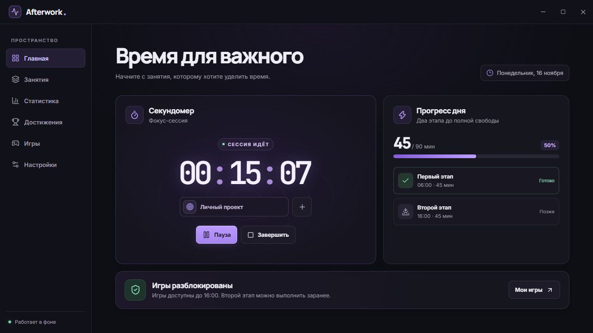

# Afterwork

**Сначала время на важное. Потом — игры.** Afterwork помогает выделять время на работу, учёбу и личные проекты, а играть — после выполнения цели.

### [Скачать Afterwork для Windows ↓](https://github.com/Linsaym/Afterwork/releases/latest)

Для **Windows 10 и 11, 64-разрядная версия**. На странице последнего выпуска в списке файлов **Assets** выберите установщик с окончанием `_x64-setup.exe`. Откройте скачанный файл и следуйте подсказкам.

## Что умеет Afterwork

- **Засекает время.** Создавайте занятия, ставьте таймер на паузу и сохраняйте заметки о том, что сделали.
- **Помогает отложить игры.** Приложение распознаёт многие установленные игры и блокирует их новые запуски до выполнения цели. Расписание и длительность фокуса можно настроить.
- **Показывает прогресс.** Смотрите историю занятий и игрового времени, открывайте достижения. История хранится на вашем компьютере.

После установки откройте **«Игры»** и проверьте список. Если нужной игры там нет, добавьте её вручную. Затем выберите занятие на главной и нажмите **«Начать сессию»**. После закрытия окна Afterwork продолжает работать в трее рядом с часами.

[Руководство для разработчиков](DEVELOPMENT.md)
